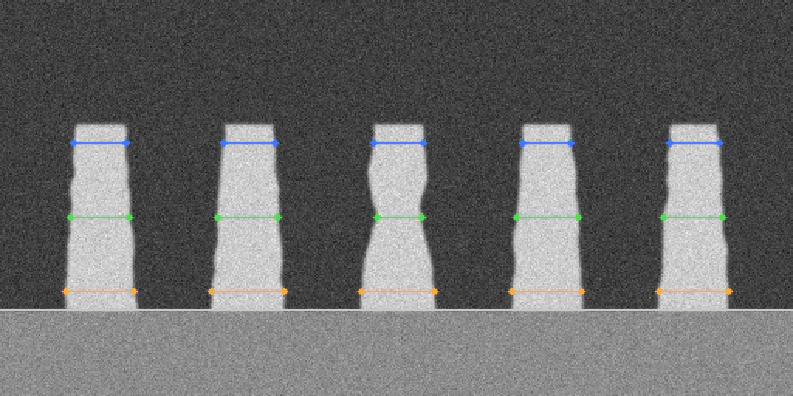
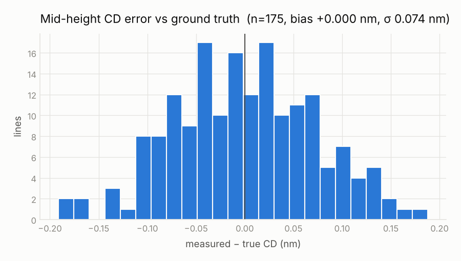
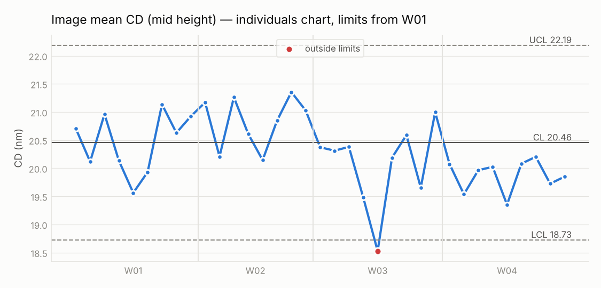
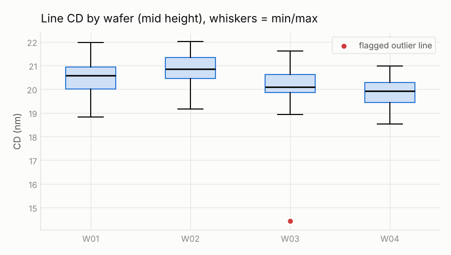
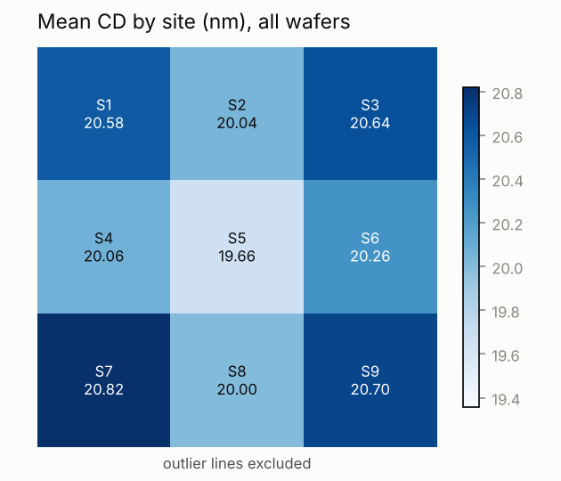

# cd-metrology

Automated critical-dimension (CD) measurement on cross-section microscopy
images, built with Python and OpenCV. Point it at a folder of images and it
finds every line structure, measures its width at the bottom, middle and top,
its height and sidewall angle, flags bad images and outlier lines, stores
everything in SQLite, and produces charts and an HTML report. A small REST API
serves the results and can measure an uploaded image on demand.

I built it to learn how dimensional metrology data is pulled out of TEM/SEM
images and how that data flows from the image to a database and a report.



*Detected edges at 10% (orange), 50% (green) and 90% (blue) of line height.
The middle line has a neck that the pipeline flags as an outlier.*

## Why synthetic images

I don't have access to real TEM cross-sections I can publish, and a
measurement you can't check against a known answer isn't worth much. So the
project includes a renderer (`cdmetro/synth.py`) that draws line arrays with
**known** geometry and then degrades them the way a microscope image is
degraded:

- trapezoid lines (sloped sidewalls) on a substrate
- slightly rough sidewalls and line-to-line CD variation
- Gaussian blur standing in for the point-spread function
- additive noise
- wafer-to-wafer offsets and a radial (edge vs centre site) signature
- two planted problems: one image with a necked line, and one low-contrast,
  noisy image

Every image is saved with a JSON sidecar holding the pixel size and the true
CD of every line, so every measurement can be scored.

## Quick start

Requires Python 3.10+.

```bash
pip install -e ".[test]"
pytest -q                                             # 19 tests

cdmetro synth --out data/lot1                         # 4 wafers x 9 sites = 36 images
cdmetro measure data/lot1 --workers 4                 # -> results/cd.sqlite, results/cd.csv
cdmetro report --images data/lot1 --out results/report --baseline-wafer W01
cdmetro serve                                         # REST API on :8000
```

To measure your own images, put them in a folder and either give each one a
`<name>.json` sidecar with `{"pixel_nm": ...}` or pass `--pixel-nm`.

## How a measurement works

`cdmetro/measure.py`, for each image:

1. **Image quality.** Noise is estimated with Immerkær's method (a Laplacian-
   like kernel, skipping pixels on strong edges). Line/background contrast
   divided by noise gives an SNR; images below 5 are rejected rather than
   measured badly.
2. **Substrate interface.** Rows inside the substrate are uniform and rows that
   cut through the lines are not, so the row-wise standard deviation drops at
   the interface. The sub-pixel position comes from the vertical intensity
   profile in the gaps between lines.
3. **Segmentation.** Otsu threshold, morphological opening and connected
   components give one region per line.
4. **Edges.** At each height, a few rows are averaged into a horizontal
   profile and smoothed. The edge is where the profile crosses 50% between
   the local background and line levels, found next to the strongest
   gradient and interpolated to sub-pixel precision. CD = right edge − left edge.
5. **Height and sidewall angle.** The line top comes from a vertical profile
   through its centre; the sidewall angle from a straight-line fit of both
   walls over 20–80% of the height.

`cdmetro/pipeline.py` runs this over a folder (optionally in parallel),
scores every line's mid-height CD with a robust z-score (median and MAD, so
the outliers don't hide themselves), flags |z| > 3.5, and writes the run to
SQLite and CSV.

## Results

On the default lot (36 images, 175 measured lines, 0.5 nm pixels):

| | value |
|---|---|
| Mid-height CD error vs truth | bias 0.000 nm, σ 0.074 nm, max 0.19 nm |
| Line height (true 60 nm) | 59.93 – 60.08 nm |
| Sidewall angle (true 86.19°) | mean 86.18° |
| Low-contrast image | rejected (SNR 1.0) |
| Necked line | the only outlier flagged (robust z ≈ −8.4) |

That is about 0.15 px of error at one standard deviation. On a 500-image lot
(2,495 lines) the error stays within 0.23 nm, and the run takes about 10 s on
one core and under 6 s with 4 worker processes on a 2-core machine.



The individuals control chart plots each image's mean CD in wafer/site
order, with limits taken from wafer W01 only. Sigma comes from the average
moving range, so drift between wafers stands out against the limits. The
necked line drags W03 / site 5 below the lower limit.



The box plot shows every line by wafer, with the flagged line in red. The site
map averages lines by site position across wafers (flagged lines left out) and
recovers the radial pattern built into the data, which makes corner sites
0.8 nm and edge sites 0.3 nm wider than the centre. Measured: corners 1.0 nm
and edges 0.4 nm wider; the difference is line-to-line variation, with only
15 to 20 lines behind each site.

<p>


</p>

`cdmetro report` also writes an HTML page ([example](docs/report.html)) with
summary, accuracy, outlier and per-image tables.

## Data and API

SQLite schema (`cdmetro/db.py`): `runs` → `images` (quality numbers, status,
reason) → `lines` (CD at three heights, height, sidewall angle, robust z,
outlier flag, ground truth when known), plus an `image_summary` view.

| Endpoint | Returns |
|---|---|
| `GET /runs` | all runs |
| `GET /runs/{id}/images?wafer=&status=` | per-image summary |
| `GET /runs/{id}/lines?outlier=&image=` | per-line results |
| `GET /runs/{id}/summary` | CD statistics, status counts, outlier count |
| `POST /measure?pixel_nm=` | measure an uploaded image (not stored) |

## Layout

```
cdmetro/
  synth.py      renderer for images with known geometry
  measure.py    quality check, segmentation, sub-pixel edges, CD/height/angle
  stats.py      robust z, control limits, accuracy
  pipeline.py   folder -> measurements -> outliers -> SQLite + CSV
  db.py         schema and queries
  report.py     charts (matplotlib) and HTML report
  api.py        FastAPI service
  cli.py        cdmetro synth | measure | report | serve
tests/          19 tests: accuracy on clean and noisy images, rejection, outliers, DB, report, API
```

## Limitations

- Validated on synthetic images only. Real TEM cross-sections have several
  materials and layers, diffraction contrast, and charging or thickness
  effects, so the segmentation and edge levels would need tuning on real data.
- The edge is defined as the 50% crossing. Real metrology recipes often use
  other definitions (maximum gradient, a model fit), and the choice shifts
  absolute CD.
- Pixel size comes from metadata; there is no scale-bar reading or
  calibration against a reference standard.
- Assumes lines are roughly vertical in the image. Tilted images would need
  rotation correction first.

## License

MIT
